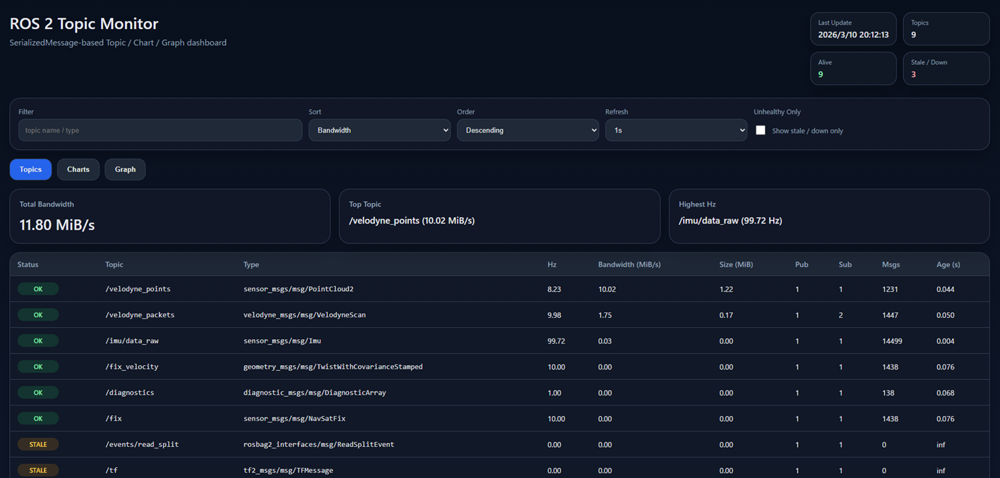
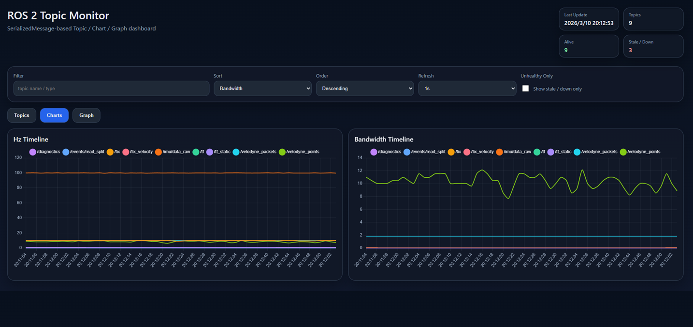
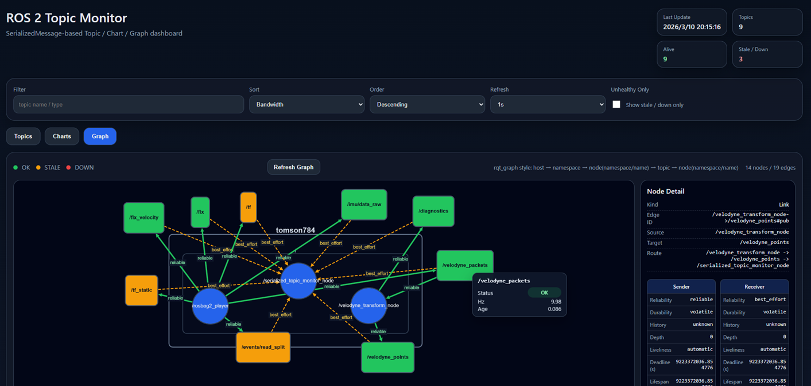

# serialized_topic_monitor

[](https://github.com/tomson784/ros2_comm_monitor/actions/workflows/ci.yml)
[](https://github.com/tomson784/ros2_comm_monitor/actions/workflows/ci.yml)

`rclcpp::SerializedMessage` を使って、メッセージを deserialize せずに ROS 2 トピックの
通信状態を監視し、Web/UI 向けの JSON を publish する C++ ノードです。

[English README](./README.md)

## 概要

`serialized_topic_monitor` は、実運用を意識した ROS 2 通信監視のためのバックエンドです。

- トピックごとの publish 周波数（Hz）を算出
- 帯域（bytes/s, MiB/s）を推定
- メッセージ到着間隔から stale 状態を判定
- UI/バックエンドが使いやすい JSON を定期 publish
- ノード/トピック/QoS 情報を含むグラフ JSON を生成

同一リポジトリ内の `topic_monitor_web_server` と組み合わせて使う想定です。

CI は `main` ブランチに対して ROS 2 Humble / Jazzy の matrix build を実行します。
現在の構成では 2 つのバッジは同じ matrix workflow を参照し、どちらかが失敗すると workflow 全体が失敗表示になります。

## ダッシュボード画面

### Topic Monitor



### Chart Monitor



### Graph Monitor



## 特徴

- `create_generic_subscription` による型文字列ベース購読
- メッセージ型ごとのテンプレート実装が不要
- 大容量トピック（Image/PointCloud など）でも payload を展開せず監視可能
- 実行時フィルタ:
  - `allowlist`
  - `denylist`
  - hidden topic 除外
  - ROS 内部トピック除外
- 監視周期・出力周期・stale 判定閾値をパラメータで調整可能
- スライディングウィンドウで Hz/帯域の値を安定化

## ノード

- 実行ファイル名: `serialized_topic_monitor_node`
- ノード名: `serialized_topic_monitor_node`

## Publish トピック

### 1) Stats JSON

- 既定トピック: `/topic_monitor/stats_json`
- 型: `std_msgs/msg/String`
- 内容: トピックごとの統計値

主なフィールド:

- `generated_at_sec`
- `topic_count`
- `topics[]`:
  - `name`
  - `type`
  - `publisher_count`
  - `subscriber_count`
  - `alive`
  - `stale`
  - `hz`
  - `bandwidth_bytes_per_sec`
  - `bandwidth_mib_per_sec`
  - `latest_message_size_bytes`
  - `latest_message_size_mib`
  - `message_count`
  - `age_sec`（未受信時は `null`）

### 2) Graph JSON

- 既定トピック: `/topic_monitor/graph_json`
- 型: `std_msgs/msg/String`
- 内容: トポロジ表示向けグラフ情報

主なフィールド:

- `node_count`
- `edge_count`
- `nodes[]`:
  - `id`, `label`
  - `node_type`（`host | namespace | node | topic`）
  - `status`（`ok | stale | down | neutral`）
  - `host`
  - `node_namespace`
  - `parent_id`
- `edges[]`:
  - `id`, `source`, `target`
  - `qos`（簡易表示）
  - 詳細 QoS:
    - `qos_reliability`
    - `qos_durability`
    - `qos_history`
    - `qos_depth`
    - `qos_liveliness`
    - `qos_deadline_sec`
    - `qos_lifespan_sec`
    - `qos_liveliness_lease_duration_sec`
    - `qos_avoid_ros_namespace_conventions`

## パラメータ

### フィルタ関連

- `allowlist`（`string[]`、既定: `[]`）
  - 空でなければ指定トピックのみ監視します。
- `denylist`（`string[]`、既定: `["/parameter_events", "/rosout"]`）
  - 指定トピックを監視対象から除外します。
- `include_hidden_topics`（`bool`、既定: `false`）
  - hidden topic を含めるか。
- `skip_internal_topics`（`bool`、既定: `true`）
  - ROS 内部トピックを除外するか。

### 周期・推定関連

- `scan_period_ms`（`int`、既定: `1000`）
  - ROS graph の再走査周期。
- `report_period_ms`（`int`、既定: `1000`）
  - JSON publish 周期。
- `stale_timeout_sec`（`double`、既定: `2.0`）
  - 最終受信からこの秒数を超えると stale 判定。
- `window_size`（`int`、既定: `20`、実効最小値: `2`）
  - Hz/帯域推定に使うスライディングウィンドウサイズ。

### 出力トピック関連

- `stats_topic`（`string`、既定: `/topic_monitor/stats_json`）
- `graph_topic`（`string`、既定: `/topic_monitor/graph_json`）

## ビルド

ワークスペースルートで実行:

```bash
colcon build --packages-select serialized_topic_monitor topic_monitor_web_server ros2_comm_monitor
source install/setup.bash
```

## 起動

```bash
ros2 run serialized_topic_monitor serialized_topic_monitor_node
```

代表的な起動例:

```bash
ros2 run serialized_topic_monitor serialized_topic_monitor_node --ros-args \
  -p allowlist:="['/points_raw','/camera/image_raw','/odom']" \
  -p denylist:="['/parameter_events','/rosout']" \
  -p include_hidden_topics:=false \
  -p skip_internal_topics:=true \
  -p report_period_ms:=1000 \
  -p scan_period_ms:=1000 \
  -p stale_timeout_sec:=2.0 \
  -p window_size:=20 \
  -p stats_topic:='/topic_monitor/stats_json' \
  -p graph_topic:='/topic_monitor/graph_json'
```

## Web Server の使い方

`topic_monitor_web_server` は `serialized_topic_monitor` が publish する JSON を
subscribe し、ブラウザ UI と HTTP API を提供します。

まとめて起動する場合:

```bash
ros2 launch ros2_comm_monitor bringup.launch.py
```

必要なら個別起動もできます:

```bash
ros2 run serialized_topic_monitor serialized_topic_monitor_node
ros2 run topic_monitor_web_server topic_monitor_web_server
```

ブラウザで以下にアクセスします:

```text
http://localhost:8080
```

利用できるパラメータ:

- `host`（`string`、既定: `0.0.0.0`）
- `port`（`int`、既定: `8080`）
- `stats_topic`（`string`、既定: `/topic_monitor/stats_json`）
- `graph_topic`（`string`、既定: `/topic_monitor/graph_json`）

ポート番号やトピック名を変える例:

```bash
ros2 launch ros2_comm_monitor bringup.launch.py \
  port:=8081 \
  stats_topic:=/topic_monitor/stats_json \
  graph_topic:=/topic_monitor/graph_json
```

HTTP エンドポイント:

- `/` または `/index.html`: ブラウザ UI
- `/api/stats`: 最新の stats JSON
- `/api/graph`: 最新の graph JSON
- `/api/hosts`: ホストごとの状態（[分散監視](#分散監視) を参照）

## 分散監視

ROS ノードが複数の PC に分散している場合は、各 PC で **agent** を 1 つずつ、マスター PC で **master** を起動します。

### 仕組み

```text
 PC A (master)                         PC B                        PC C
 ┌───────────────────────────┐   ┌──────────────────────┐   ┌──────────────────────┐
 │ agent A ─ A で publish    │   │ agent B ─ B で       │   │ agent C ─ C で       │
 │           されたトピック  │   │   publish された     │   │   publish された     │
 │ web server ◀── stats/graph JSON ─┤ トピックを計測   │   │ トピックを計測       │
 │   (全ホストを集約)        │◀──────────────────────────────── stats/graph JSON    │
 └───────────────────────────┘   └──────────────────────┘   └──────────────────────┘
```

- トピックのデータ本体は **publish している PC の中だけ** で計測します。publisher が他 PC にある
  トピックを agent は subscribe しないため、監視のためにデータ本体が PC 間を流れることはありません。
- 各 agent は小さな stats/graph JSON（`/topic_monitor/stats_json`, `/topic_monitor/graph_json`）だけを送ります。
- マスターの web server が全ホストの JSON を集約して UI に表示します。

agent は scan のたびに、publisher の所在でトピックを分類します。

| `locality` | publisher | 報告 | subscribe（計測） |
|---|---|---|---|
| `local` | すべて自 PC | する | する |
| `mixed` | 自 PC と他 PC の両方 | する | `subscribe_policy:=any_local` のときだけ |
| `orphan` | なし（自 PC に subscriber あり） | DOWN として報告 | しない |
| （報告しない） | 他 PC のみ | しない（その PC の agent が報告） | しない |

「自 PC かどうか」はエンドポイントの GID で判定します。Fast DDS の GUID は先頭 2 バイトがベンダー ID
（`0x01 0x0F`）、2〜3 バイト目がホスト ID なので、agent 自身の publisher の GID と比較します。
stats/graph トピックを publish / subscribe しているノード（agent や web server）は監視ツール自身とみなし、
件数とグラフから除外します。

### 起動方法

マスター以外の各 PC:

```bash
ros2 launch ros2_comm_monitor agent.launch.py
```

マスター PC（web server と、`with_agent:=true`（既定）ならマスター自身の agent も起動）:

```bash
ros2 launch ros2_comm_monitor master.launch.py
```

agent のノード名は `comm_monitor_agent_<hostname>`（英数字以外は `_` に変換）です。
`bringup.launch.py` は 1 台用（agent と web server を同じ PC で起動）として残しています。
全 PC で `ROS_DOMAIN_ID` を揃え、互いにノード探索できる状態にしてください。

### agent のパラメータ

- `host_name`（`string`、既定: `gethostname()`）: UI に表示するホスト名。
- `locality_mode`（`auto | all`、既定: `auto`）
  - `auto`: 自 PC で publish されたトピックだけを計測。
  - `all`: 全エンドポイントを自 PC 扱い（従来の動作。他 PC のデータ本体もネットワーク越しに受信します）。
- `subscribe_policy`（`local_only | any_local`、既定: `local_only`）
  - `local_only`: `mixed` トピックは報告するが計測しない。
  - `any_local`: `mixed` トピックも計測する（他 PC のデータ本体も受信します）。
- `local_node_namespaces`（`string[]`）/ `local_node_names`（`string[]`）
  - 自 PC 扱いにする名前空間 / ノード名（名前または FQN）。末尾が `*` なら前方一致。
  - GID からホストを判定できない Fast DDS 以外の RMW 向けです。
- 環境変数 `ROS_AUTOMATIC_DISCOVERY_RANGE=LOCALHOST` または `ROS_LOCALHOST_ONLY=1` のときは、全エンドポイントを自 PC 扱いにします。
- `locality_mode:=auto` で RMW が Fast DDS ではなく、`local_node_*` の設定もない場合は、起動時に WARN を出し、何も計測しません。

例（Cyclone DDS で、ロボットのノードが全て `/robot1` 配下にある場合）:

```bash
ros2 launch ros2_comm_monitor agent.launch.py local_node_namespaces:="['/robot1*']"
```

### master のパラメータ

- `agent_timeout_sec`（`double`、既定: `5.0`）: この時間 JSON が来ない PC を offline にする。
- `forget_after_sec`（`double`、既定: `300.0`）: この時間 JSON が来ない PC を一覧から削除する。
- web server は reliable・depth 50 で購読し、複数 PC の JSON が上書きし合わないようにしています。
  agent 側は reliable・depth 10 で publish します。

### JSON の変更点（schema_version 2）

- stats（全体）: `schema_version`, `host`, `agent_node`, `rmw`, `locality_mode`, `subscribe_policy`
- stats（トピックごと）: `host`, `monitored`, `locality`, `local_publisher_count`, `remote_publisher_count`
- graph: 自 PC のノードとエッジだけを出力。トピックのノード ID はトピック名（全 PC 共通）、
  ROS ノードの ID は `node://<host>::<fqn>`。自 PC で計測していないトピックの status は `neutral`。
- `host` のない旧形式の JSON は、ホスト `local` として扱います。

### 集約 API（master）

- `/api/stats`: (host, topic) ごとに 1 行。offline の PC の行は `stale=true`, `host_online=false`。
  `hosts`, `host_count`, `online_host_count` も含みます。
- `/api/graph`: 全ホストのノードとエッジの和集合。複数ホストが報告するトピックは良いほうの status
  （`ok > stale > down > neutral`）を採用。host ノードは online なら `ok`、offline なら `down`。
- `/api/hosts`: ホストごとの `online`, `last_seen_age_sec`, `agent_node`, `rmw`, `locality_mode`,
  `subscribe_policy`, `topic_count`, `monitored_topic_count`。

UI には、ホスト一覧バー（online/offline、計測中のトピック数、最終受信からの秒数）、Host 列、
`NOT MEASURED` / `HOST OFFLINE` バッジが表示されます。PC が 2 台以上のときは、グラフの系列名が `topic @host` になります。

## テスト

```bash
colcon test --packages-select serialized_topic_monitor topic_monitor_web_server
colcon test-result --verbose
```

## 実装メモ

- 帯域はシリアライズ済みメッセージサイズから推定しています。
- 計算式:
  - `hz = (N - 1) / (t_last - t_first)`
  - `bandwidth_bytes_per_sec = sum(size[1..N-1]) / (t_last - t_first)`
- 依存を増やさないため、JSON は手動でエスケープして組み立てています。

## 制約

- 自動判定（`locality_mode:=auto`）は Fast DDS のみ対応です。GUID 中の 16 bit のホスト ID を使うため、まれに別 PC 間で衝突することがあります。その場合は `local_node_*` の明示設定か `locality_mode:=all` を使ってください。
- `mixed` トピック（publisher が複数 PC にある）は、既定の `subscribe_policy:=local_only` では計測しません（NOT MEASURED として報告）。
- ホストを判定できないエンドポイント（agent と異なる RMW のノードなど）は、`local_node_namespaces` / `local_node_names` に一致しない限り自 PC 扱いになりません。
- QoS は graph API から得られる情報に依存し、複雑なネットワークでは見え方に差が出る場合があります。
- 本パッケージは通信状態監視が目的で、メッセージ内容の意味的妥当性検証は行いません。
