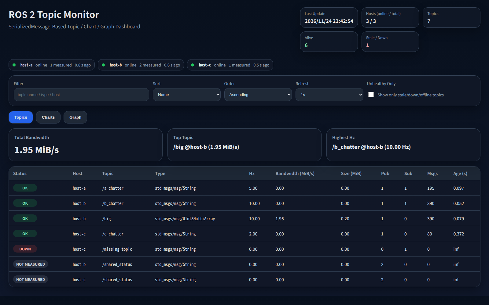
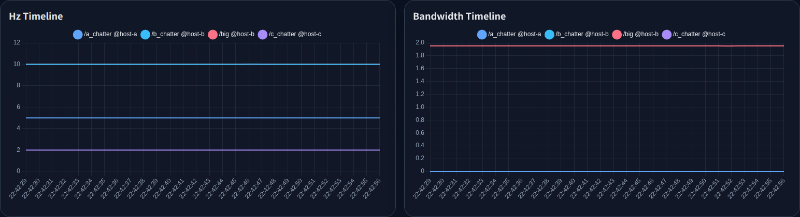
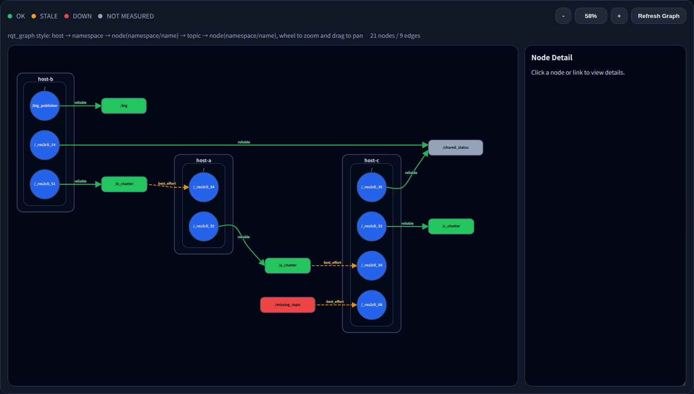

# serialized_topic_monitor

[](https://github.com/tomson784/ros2_comm_monitor/actions/workflows/ci.yml)
[](https://github.com/tomson784/ros2_comm_monitor/actions/workflows/ci.yml)

ROS 2 C++ monitor node that observes topic activity using `rclcpp::SerializedMessage`
without deserializing message payloads, then publishes JSON for web/dashboard consumers.

[日本語版 README](./README.ja.md)

## Overview

`serialized_topic_monitor` is designed for production-friendly runtime monitoring of ROS 2 topic traffic:

- Tracks per-topic publish rate (`Hz`)
- Estimates bandwidth (`bytes/s`, `MiB/s`)
- Detects stale topics using message age and timeout
- Publishes machine-readable JSON snapshots for UI/backend services
- Builds a graph view payload including nodes, topics, edges, and QoS metadata

This package is the backend monitor component used by the sibling package
`topic_monitor_web_server`.

The CI workflow runs a matrix build for both ROS 2 Humble and Jazzy on `main`.
Each badge points to the same matrix workflow, so a failure in either distro marks the workflow failed.

## Dashboard Screenshots

Three PCs (simulated with Docker) monitored from one dashboard.
How to read each screen, the overall architecture, and the classification / merge rules are described in
**[System Overview (docs/system_overview.md)](./docs/system_overview.md)**.

### Topic Monitor



### Chart Monitor



### Graph Monitor



## Features

- Generic subscription (`create_generic_subscription`) by topic type string
- No template specialization per message type required
- Supports large/high-throughput topics (e.g. image/point cloud) by observing serialized size
- Runtime filtering:
  - `allowlist`
  - `denylist`
  - hidden-topic filtering
  - ROS internal-topic filtering
- Runtime tunable scan/report intervals and stale threshold
- Sliding-window estimator for stable frequency/bandwidth values

## Node

- Executable: `serialized_topic_monitor_node`
- Node name: `serialized_topic_monitor_node`

## Published Topics

### 1) Stats JSON

- Topic name (default): `/topic_monitor/stats_json`
- Type: `std_msgs/msg/String`
- Payload: JSON object with topic list and computed metrics

Main fields:

- `generated_at_sec`
- `topic_count`
- `topics[]`:
  - `name`
  - `type`
  - `publisher_count`
  - `subscriber_count`
  - `alive`
  - `stale`
  - `hz`
  - `bandwidth_bytes_per_sec`
  - `bandwidth_mib_per_sec`
  - `latest_message_size_bytes`
  - `latest_message_size_mib`
  - `message_count`
  - `age_sec` (`null` if never received)

### 2) Graph JSON

- Topic name (default): `/topic_monitor/graph_json`
- Type: `std_msgs/msg/String`
- Payload: JSON graph for topology visualization

Main fields:

- `node_count`
- `edge_count`
- `nodes[]`:
  - `id`, `label`
  - `node_type` (`host | namespace | node | topic`)
  - `status` (`ok | stale | down | neutral`)
  - `host`
  - `node_namespace`
  - `parent_id`
- `edges[]`:
  - `id`, `source`, `target`
  - `qos` (short reliability label)
  - detailed QoS:
    - `qos_reliability`
    - `qos_durability`
    - `qos_history`
    - `qos_depth`
    - `qos_liveliness`
    - `qos_deadline_sec`
    - `qos_lifespan_sec`
    - `qos_liveliness_lease_duration_sec`
    - `qos_avoid_ros_namespace_conventions`

## Parameters

### Filtering

- `allowlist` (`string[]`, default: `[]`)
  - If non-empty, monitor only these topics.
- `denylist` (`string[]`, default: `["/parameter_events", "/rosout"]`)
  - Always excludes listed topics.
- `include_hidden_topics` (`bool`, default: `false`)
  - Include hidden topics (such as names ending with `/_*`) if `true`.
- `skip_internal_topics` (`bool`, default: `true`)
  - Excludes known internal/system topics.

### Timing / Estimation

- `scan_period_ms` (`int`, default: `1000`)
  - ROS graph scan period for creating/removing monitors.
- `report_period_ms` (`int`, default: `1000`)
  - Publish period for stats/graph JSON.
- `stale_timeout_sec` (`double`, default: `2.0`)
  - Topic is marked stale when no message is received longer than this threshold.
- `window_size` (`int`, default: `20`, minimum effective value: `2`)
  - Sliding window size used for `hz` and bandwidth estimation.

### Output Topics

- `stats_topic` (`string`, default: `/topic_monitor/stats_json`)
- `graph_topic` (`string`, default: `/topic_monitor/graph_json`)

## Build

From your ROS 2 workspace root:

```bash
colcon build --packages-select serialized_topic_monitor topic_monitor_web_server ros2_comm_monitor
source install/setup.bash
```

## Run

```bash
ros2 run serialized_topic_monitor serialized_topic_monitor_node
```

Run with custom parameters:

```bash
ros2 run serialized_topic_monitor serialized_topic_monitor_node --ros-args \
  -p allowlist:="['/points_raw','/camera/image_raw','/odom']" \
  -p denylist:="['/parameter_events','/rosout']" \
  -p include_hidden_topics:=false \
  -p skip_internal_topics:=true \
  -p report_period_ms:=1000 \
  -p scan_period_ms:=1000 \
  -p stale_timeout_sec:=2.0 \
  -p window_size:=20 \
  -p stats_topic:='/topic_monitor/stats_json' \
  -p graph_topic:='/topic_monitor/graph_json'
```

## Web Server

`topic_monitor_web_server` subscribes to the JSON topics from
`serialized_topic_monitor` and serves a browser UI plus simple HTTP APIs.

Start both nodes together:

```bash
ros2 launch ros2_comm_monitor bringup.launch.py
```

You can still start them separately if needed:

```bash
ros2 run serialized_topic_monitor serialized_topic_monitor_node
ros2 run topic_monitor_web_server topic_monitor_web_server
```

Open the UI in your browser:

```text
http://localhost:8080
```

Available parameters:

- `host` (`string`, default: `0.0.0.0`)
- `port` (`int`, default: `8080`)
- `stats_topic` (`string`, default: `/topic_monitor/stats_json`)
- `graph_topic` (`string`, default: `/topic_monitor/graph_json`)

Example with custom port and topic names:

```bash
ros2 launch ros2_comm_monitor bringup.launch.py \
  port:=8081 \
  stats_topic:=/topic_monitor/stats_json \
  graph_topic:=/topic_monitor/graph_json
```

HTTP endpoints:

- `/` or `/index.html`: browser UI
- `/api/stats`: latest stats JSON
- `/api/graph`: latest graph JSON
- `/api/hosts`: per-host status (see [Distributed Monitoring](#distributed-monitoring))

## Distributed Monitoring

When ROS nodes are spread over several PCs, run one **agent** per PC and one **master**.

### How it works

```text
 PC A (master)                         PC B                        PC C
 ┌───────────────────────────┐   ┌──────────────────────┐   ┌──────────────────────┐
 │ agent A ─ measures topics │   │ agent B ─ measures   │   │ agent C ─ measures   │
 │           published on A  │   │   topics published   │   │   topics published   │
 │ web server ◀── stats/graph JSON ─┤   on B             │   │   on C               │
 │   (merges all hosts)      │◀──────────────────────────────── stats/graph JSON    │
 └───────────────────────────┘   └──────────────────────┘   └──────────────────────┘
```

- Topic payloads are measured **only on the PC that publishes them**; agents never subscribe to a
  topic whose publishers live on another PC, so no payload crosses the network for monitoring.
- Each agent publishes only small stats/graph JSON (`/topic_monitor/stats_json`, `/topic_monitor/graph_json`).
- The master's web server merges the JSON from every host and serves the UI.

Each scan, an agent classifies every topic by where its publishers are:

| `locality` | Publishers | Reported | Subscribed (measured) |
|---|---|---|---|
| `local` | all on this PC | yes | yes |
| `mixed` | on this PC and other PCs | yes | only with `subscribe_policy:=any_local` |
| `orphan` | none, but a subscriber on this PC | yes, as DOWN | no |
| (not reported) | only on other PCs | no (that PC's agent reports it) | no |

"Same PC" is decided from the endpoint GID: with Fast DDS, bytes 0–1 of the GUID are the vendor id
(`0x01 0x0F`) and bytes 2–3 are the host id, which is compared with the agent's own publisher GID.
Nodes that publish or subscribe the stats/graph topics (agents, web servers) are treated as the
monitor itself and excluded from counts and from the graph.

### Launch

On every PC except the master:

```bash
ros2 launch ros2_comm_monitor agent.launch.py
```

On the master PC (starts the web server and, with `with_agent:=true` (default), the master's own agent):

```bash
ros2 launch ros2_comm_monitor master.launch.py
```

The agent node is named `comm_monitor_agent_<hostname>` (non-alphanumerics replaced by `_`).
`bringup.launch.py` is kept for single-PC use (agent + web server on one PC).
All PCs must share the same `ROS_DOMAIN_ID` and be able to discover each other.

### Agent parameters

- `host_name` (`string`, default: `gethostname()`): host name shown in the UI.
- `locality_mode` (`auto | all`, default: `auto`)
  - `auto`: measure only topics published on this PC.
  - `all`: treat every endpoint as local (previous behavior; pulls remote payloads over the network).
- `subscribe_policy` (`local_only | any_local`, default: `local_only`)
  - `local_only`: `mixed` topics are reported but not measured.
  - `any_local`: also measure `mixed` topics (remote payloads are received as well).
- `local_node_namespaces` (`string[]`) / `local_node_names` (`string[]`)
  - Namespaces / node names (name or FQN) to treat as local. A trailing `*` means prefix match.
  - Needed for RMWs other than Fast DDS, where the host cannot be derived from the GID.
- If `ROS_AUTOMATIC_DISCOVERY_RANGE=LOCALHOST` or `ROS_LOCALHOST_ONLY=1`, every endpoint is local.
- With `locality_mode:=auto`, a non-Fast-DDS RMW and no `local_node_*` setting, the agent logs a
  WARN at startup and measures nothing.

Example (Cyclone DDS on a robot whose nodes all live under `/robot1`):

```bash
ros2 launch ros2_comm_monitor agent.launch.py local_node_namespaces:="['/robot1*']"
```

### Master parameters

- `agent_timeout_sec` (`double`, default: `5.0`): a host that sent no JSON for this long is shown offline.
- `forget_after_sec` (`double`, default: `300.0`): a host that sent no JSON for this long is removed.
- The web server subscribes with reliable QoS, depth 50, so payloads from many hosts do not overwrite each other.
  Agents publish with reliable QoS, depth 10.

### JSON changes (schema_version 2)

- stats (top level): `schema_version`, `host`, `agent_node`, `rmw`, `locality_mode`, `subscribe_policy`
- stats (per topic): `host`, `monitored`, `locality`, `local_publisher_count`, `remote_publisher_count`
- graph: only this PC's nodes/edges. Topic node ids are the topic names (shared by all PCs);
  ROS node ids are `node://<host>::<fqn>`. Topics not measured on this PC have status `neutral`.
- Payloads without `host` (older agents) are treated as host `local`.

### Merged API (master)

- `/api/stats`: one row per (host, topic). Rows of offline hosts have `stale=true`, `host_online=false`.
  Also contains `hosts`, `host_count`, `online_host_count`.
- `/api/graph`: union of all hosts' nodes and edges. A topic reported by several hosts takes the best
  status (`ok > stale > down > neutral`), with online hosts' judgements taking precedence over offline hosts'
  last data (see [System Overview](./docs/system_overview.md#42-merge-rules)). Host nodes are `ok` when online, `down` when offline.
- `/api/hosts`: per-host `online`, `last_seen_age_sec`, `agent_node`, `rmw`, `locality_mode`,
  `subscribe_policy`, `topic_count`, `monitored_topic_count`.

The UI shows a host bar (online/offline, measured topics, seconds since last JSON), a Host column,
`NOT MEASURED` / `HOST OFFLINE` badges, and chart series named `topic @host` when 2+ hosts exist.

## Test

```bash
colcon test --packages-select serialized_topic_monitor topic_monitor_web_server
colcon test-result --verbose
```

### Multi-host test (Docker)

`test/multihost/` simulates three PCs with docker compose on an isolated bridge network
(each container has its own network namespace, hostname, `/etc/machine-id` and `/dev/shm`):

- `master` (Jazzy): web server + agent, publishes `/a_chatter`, subscribes `/b_chatter`
- `host_b` (Jazzy): agent, publishes `/big` (200 KiB x 10 Hz) and `/b_chatter`
- `host_c` (Humble): agent, publishes `/c_chatter`, subscribes `/a_chatter`

```bash
test/multihost/run_test.sh          # exit code 0 = all checks passed; results in test/multihost/results/
test/multihost/demo_screenshots.sh  # adds demo topics and captures UI screenshots into docs/screenshots/ (needs Python Playwright)
```

While the stack is running, the master UI is at `http://127.0.0.1:18090` (change with `MASTER_HTTP_PORT`).

It checks per-host measurement and graph placement, the master's received traffic with
`locality_mode:=auto` vs `all`, and that a stopped host turns offline.
Docker must be usable without sudo, and the `ros:jazzy-ros-base-noble` / `ros:humble-ros-base-jammy` images must be available (pulled automatically if missing).

## Design Notes

- Bandwidth is estimated from serialized message sizes observed at subscription callback time.
- The estimator computes:
  - `hz = (N - 1) / (t_last - t_first)`
  - `bandwidth_bytes_per_sec = sum(size[1..N-1]) / (t_last - t_first)`
- All JSON is generated manually with escaping to keep dependencies minimal.

## Limitations

- Automatic host detection (`locality_mode:=auto`) works with Fast DDS only. It relies on the 16-bit host id in the GUID, which can (rarely) collide between two PCs; use `host_name` / `local_node_*` or `locality_mode:=all` if that happens.
- `mixed` topics (publishers on several PCs) are not measured with the default `subscribe_policy:=local_only`; they are reported as NOT MEASURED.
- Endpoints whose host cannot be determined (e.g. nodes using a different RMW than the agent) are not treated as local unless matched by `local_node_namespaces` / `local_node_names`.
- Mixing ROS distributions (e.g. Humble and Jazzy agents): data and JSON flow normally, but each side sees the other's node names as `_NODE_NAME_UNKNOWN_` (incompatible `ros_discovery_info`). Agents then identify the other side's monitor tooling by DDS participant instead of by name; since each agent only emits its own host's nodes, the merged graph is unaffected. ROS 2 does not officially support cross-distro communication.
- QoS metadata is derived from discovered publisher/subscriber info; mismatches may exist in complex networks.
- This package focuses on monitoring transport-level behavior, not semantic message validity.
