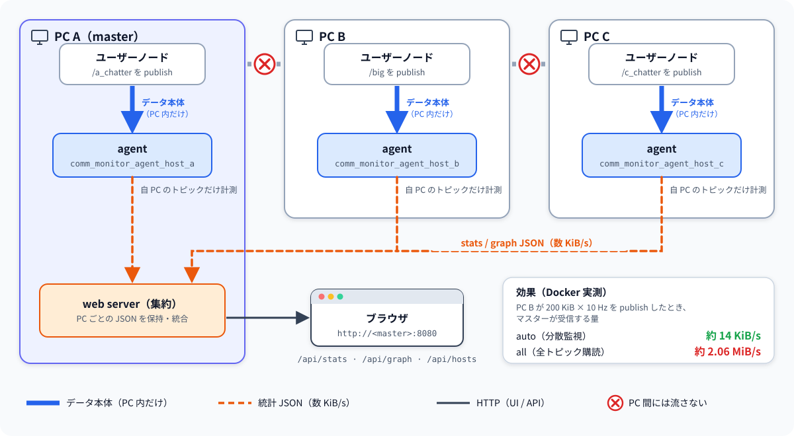
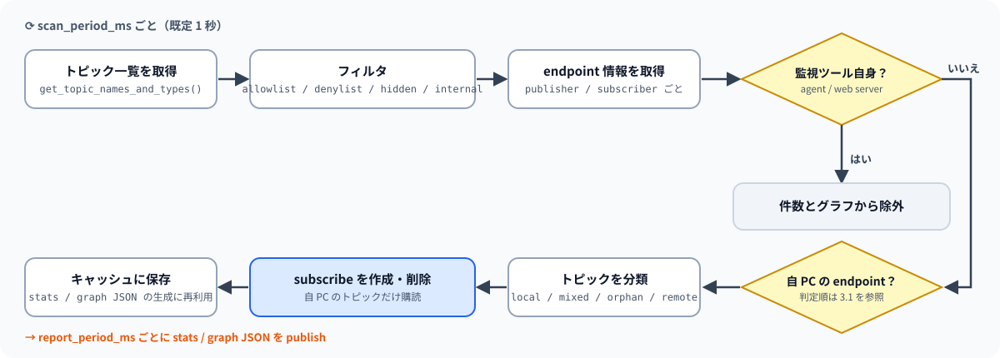
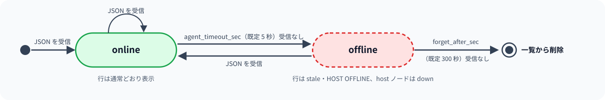
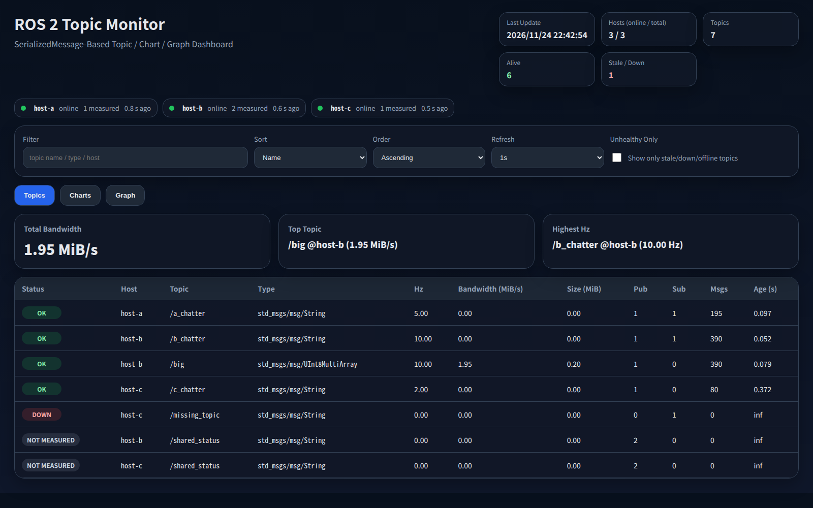
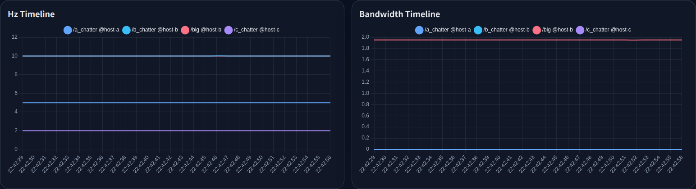
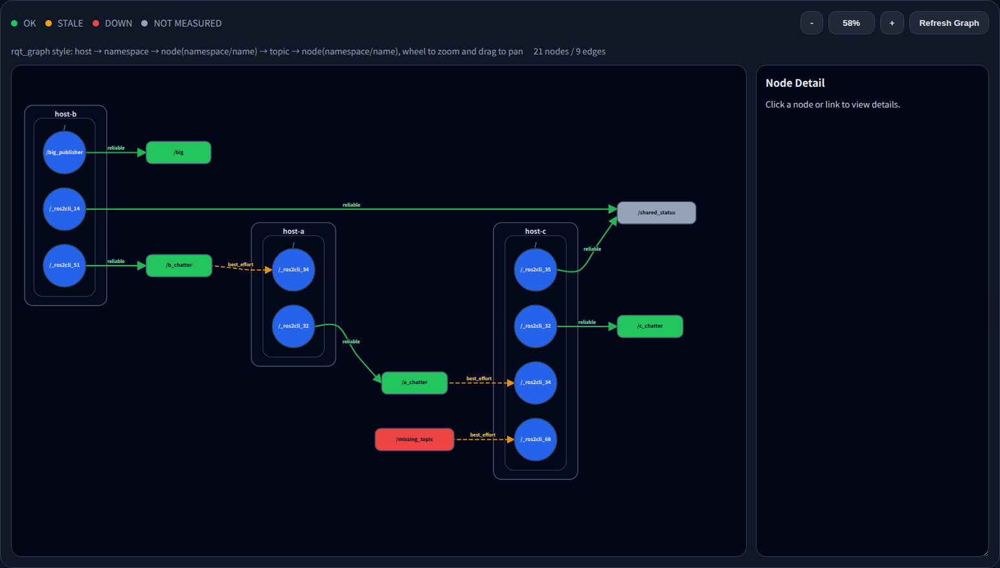
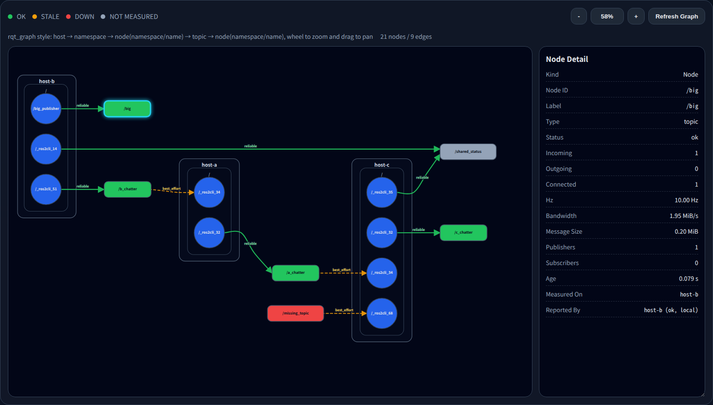
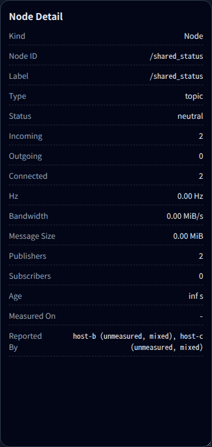
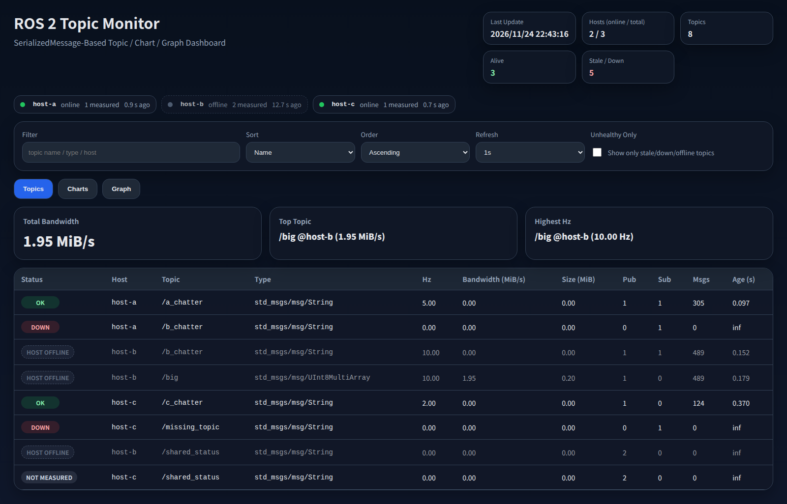
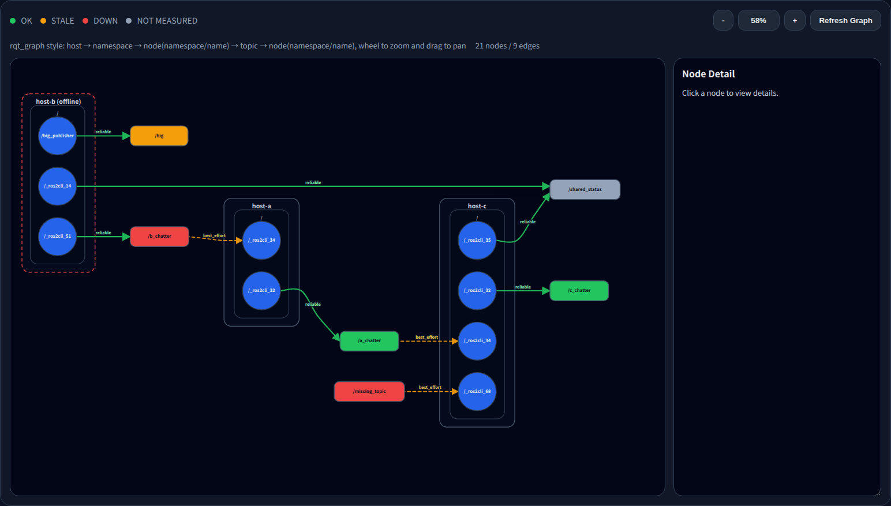

# システム概要：ros2_comm_monitor（分散監視対応版）

[English](./system_overview.md) ・ [README](../README.ja.md)

このドキュメントでは、複数の PC にまたがる ROS 2 システムを監視するときの
全体構成、各コンポーネントの役割、判定とマージのルール、Web UI の見え方を説明します。
パラメータの一覧は README の「分散監視」の節を参照してください。

画面のスクリーンショットは、すべて `test/multihost/demo_screenshots.sh` で撮影したものです
（Docker で 3 台の PC を模擬。[UI の見え方](#5-web-ui-の見え方) を参照）。

---

## 1. 全体像



設計の要点は次の 3 つです。

| 方針 | 内容 |
|---|---|
| データ本体は PC 外に出さない | agent は「自 PC で publish されているトピック」だけを subscribe する。他 PC のトピックは、その PC の agent が計測する |
| 送るのは統計 JSON だけ | 各 agent は 1 秒ごとに Hz・帯域・接続情報の JSON（stats / graph）を publish する |
| 集約はマスターで行う | web server がホストごとに最新の JSON を保持し、マージして UI と API に出す |

効果（Docker での実測。PC B が 200 KiB × 10 Hz を publish しているとき、マスターが受信する量）:

| マスターの agent の設定 | マスターの受信量 |
|---|---|
| `locality_mode:=auto`（分散監視） | 約 14 KiB/s |
| `locality_mode:=all`（従来どおり全トピックを購読） | 約 2.06 MiB/s |

---

## 2. コンポーネント

| パッケージ | 実行単位 | 役割 |
|---|---|---|
| `serialized_topic_monitor` | `serialized_topic_monitor_node`（agent） | 各 PC で 1 つ起動。自 PC のトピックを `GenericSubscription` で購読し、デシリアライズせずに Hz・帯域・stale を計測。stats / graph JSON を publish |
| `topic_monitor_web_server` | `topic_monitor_web_server`（master） | 全 agent の JSON を購読して `ClusterState` に保持。マージした結果を HTTP で配信し、静的ファイル（UI）も返す |
| `ros2_comm_monitor` | launch ファイル | `agent.launch.py`（各 PC）、`master.launch.py`（マスター。既定で自身の agent も起動）、`bringup.launch.py`（1 台用の互換）。引数の定義は `ros2_comm_monitor.launch_common` に集約 |

主なソースファイル:

| ファイル | 内容 |
|---|---|
| `serialized_topic_monitor/src/locality.cpp` | GID からのホスト判定（`is_fastdds_gid` / `compare_host` / `gid_host_tag` / `gid_participant_prefix`）、名前パターンの照合 |
| `serialized_topic_monitor/src/serialized_topic_monitor.cpp` | scan、トピックの分類、subscribe の管理、JSON の生成 |
| `topic_monitor_web_server/topic_monitor_web_server/web_server.py` | `ClusterState`（ホストごとの保持、offline の判定、マージ）、HTTP ハンドラ |
| `topic_monitor_web_server/static/app.js` | UI（表、チャート、ELK によるグラフ描画） |

---

## 3. agent の処理（1 回の scan）

agent は `scan_period_ms`（既定 1 秒）ごとに ROS グラフを走査し、結果をキャッシュします。
stats / graph JSON は、このキャッシュから `report_period_ms`（既定 1 秒）ごとに生成します。



### 3.1 「自 PC か」の判定順

各 endpoint について、上から順に判定します。

| 順 | 条件 | 結果 |
|---|---|---|
| 1 | `locality_mode:=all`、または環境変数 `ROS_AUTOMATIC_DISCOVERY_RANGE=LOCALHOST` / `ROS_LOCALHOST_ONLY=1` | 自 PC |
| 2 | ノードの名前空間が `local_node_namespaces` に一致、またはノード名・FQN が `local_node_names` に一致（末尾 `*` は前方一致） | 自 PC |
| 3 | Fast DDS の場合：endpoint の GID の 2〜3 バイト目（ホスト ID）が、agent 自身の publisher の GID と同じ | 自 PC |
| 4 | 上記以外（他 PC、または判定できない） | 他 PC |

Fast DDS の GUID の構造（GID の先頭 12 バイト）:

```text
 byte:  0    1  | 2    3  | 4  5  6  7 | 8  9 10 11 | 12..15
       0x01 0x0F| host id |  process id | participant| entity id
       vendor id|          |             |  counter   |
```

Fast DDS 以外の RMW で、`locality_mode:=auto` かつ `local_node_*` の設定もない場合は、
起動時に WARN を出し、何も計測しません（他 PC のトピックを誤って購読しないための安全側の動作です）。

### 3.2 トピックの分類

| `locality` | publisher の所在 | stats に報告 | subscribe（計測） | graph の status |
|---|---|---|---|---|
| `local` | すべて自 PC | する | する | 計測結果（ok / stale / down） |
| `mixed` | 自 PC と他 PC の両方 | する | `subscribe_policy:=any_local` のときだけ | 計測しないなら `neutral` |
| `orphan` | なし（自 PC に subscriber あり） | DOWN として報告 | しない | `down` |
| `remote` | 他 PC のみ | しない（その PC の agent が報告） | しない | `neutral`（自 PC の subscriber がいる場合だけグラフに出る） |

### 3.3 監視ツール自身の除外

stats / graph トピックを publish または subscribe しているノード（各 PC の agent、web server）は
監視ツール自身とみなし、件数とグラフから除外します。

- 通常は、ノードの FQN で判定します。
- ノード名が `_NODE_NAME_UNKNOWN_` になる場合（Humble と Jazzy の混在など。`ros_discovery_info` の互換性がないため）は、
  名前ではなく DDS participant（GID の先頭 12 バイト＝プロセス）で判定します。
  不明な名前をそのまま登録すると、名前が不明な endpoint がすべて除外されてしまうためです
  （Docker の Humble/Jazzy 混在テストで見つけて修正しました）。

---

## 4. マスターでの集約（ClusterState）

`ClusterState` は、ホスト名（JSON の `host`。ない旧形式は `local`）ごとに、
最新の stats / graph と受信時刻を保持します。時計は差し替え可能で、テストでは偽の時計を使います。

### 4.1 ホストの状態



### 4.2 マージのルール

| 対象 | ルール |
|---|---|
| stats | (host, topic) ごとに 1 行。offline のホストの行は `stale=true`、`host_online=false` |
| graph のノードとエッジ | 全ホストの和集合（ID で重複を除く）。トピックのノード ID はトピック名（全 PC 共通）、ROS ノードの ID は `node://<host>::<fqn>` |
| graph の host ノード | online なら `ok`、offline なら `down` |
| graph のトピックの status | 複数のホストが報告するときは、下の優先順位で決める |

トピックの status の優先順位（上ほど優先）:

1. online のホストの判定：`ok` > `stale` > `down`
2. offline のホストが最後に報告した判定：`ok`（→ `stale` に格下げ）> `stale` > `down`
3. `neutral`（どのホストも計測していない）

offline のホストの古いデータが、生きているホストの判定を上書きしないようにするためです。
たとえば publisher のいる PC が止まると、そのトピックは、subscriber 側の PC の判定（`down`）で表示されます。
UI のグラフも同じ優先順位を使います。

### 4.3 API

| エンドポイント | 内容 |
|---|---|
| `/api/stats` | マージ済みの stats（`topics[]` は (host, topic) ごと）。`hosts`、`host_count`、`online_host_count` も含む |
| `/api/graph` | マージ済みの graph |
| `/api/hosts` | ホストごとの `online`、`last_seen_age_sec`、`agent_node`、`rmw`、`locality_mode`、`subscribe_policy`、`topic_count`、`monitored_topic_count` |

購読の QoS は reliable・depth 50（agent 側は reliable・depth 10）です。複数の PC の JSON が上書きし合わないようにしています。
不正な JSON は無視して件数を数え、WARN をログに出します（10 秒に 1 回に間引き）。

---

## 5. Web UI の見え方

以下は Docker で 3 台を模擬した環境の画面です。

| PC | ROS | 動いているもの |
|---|---|---|
| host-a（master） | Jazzy | web server と agent。`/a_chatter` を publish、`/b_chatter` を subscribe |
| host-b | Jazzy | agent。`/big`（200 KiB × 10 Hz）、`/b_chatter`、`/shared_status` を publish |
| host-c | Humble | agent。`/c_chatter`、`/shared_status` を publish。`/a_chatter`、`/missing_topic` を subscribe |

`/shared_status` は 2 台が publish する `mixed` のトピック、
`/missing_topic` は subscriber しかいない `orphan` のトピックの例です。
グラフに出る `/_ros2cli_*` は、デモで使っている `ros2 topic pub` / `ros2 topic echo` のノードです。

### 5.1 Topics タブ



- **ヘッダー**：`Hosts (online / total)` に online 数と全数を表示します。`Stale / Down` には DOWN、STALE、HOST OFFLINE の行を数えます（NOT MEASURED は数えません）。
- **ホストの一覧バー**：ホストごとに online / offline、計測中のトピック数、最終受信からの秒数を表示します。マウスを乗せると、agent のノード名、RMW、`locality_mode`、`subscribe_policy` が出ます。

  

- **表**：(host, topic) ごとに 1 行です。Host 列で、どの PC が計測したかが分かります。
  フィルタの対象は topic 名、型、host です。ソートには Host を追加しました。
  行にマウスを乗せると、`locality` と publisher の内訳（自 PC / 他 PC）が出ます。
- **Top Topic / Highest Hz**：PC が 2 台以上のときは `topic @host` の形で表示します。

Status 列のバッジ:

| バッジ | 意味 |
|---|---|
| `OK` | 計測中で、`stale_timeout_sec` 以内に受信している |
| `STALE` | 計測中だが、しばらく受信していない |
| `DOWN` | publisher がいない（orphan） |
| `NOT MEASURED` | 報告はあるが、この PC では計測していない（`mixed` で `local_only` の場合） |
| `HOST OFFLINE` | 報告している PC の agent から JSON が届いていない。値は最後に受信したもので、行は薄く表示される |

### 5.2 Charts タブ



計測中のトピックだけを描きます（NOT MEASURED は描きません）。
PC が 2 台以上のときは、系列名が `topic @host` になります。

### 5.3 Graph タブ



- host → namespace → node の入れ子で、各ノードは自分の PC の枠の中に描かれます。
- トピックのノードは全 PC で共通です。PC をまたぐ通信（例：host-b の `/b_chatter` → host-a の subscriber）は、PC の枠をまたぐエッジとして表示されます。
- トピックの色：緑 = OK、橙 = STALE、赤 = DOWN、**灰 = NOT MEASURED**（どの PC でも計測していない）。
- エッジの色と線種は、reliability の QoS を表します（reliable = 緑の実線、best_effort = 橙の破線）。

トピックをクリックすると、右のパネルに詳細を表示します。
`Measured On` は計測した PC、`Reported By` は報告した PC ごとの状態です。



`mixed` のトピック（/shared_status）の詳細。2 台が報告していますが、どちらも計測していません。



### 5.4 PC が停止したとき（host-b の agent を停止）

約 5 秒（`agent_timeout_sec`）後に offline になります。



- ホストの一覧バーで host-b が offline（灰色の点線の枠）になり、最終受信からの秒数が増えていきます。
- host-b の行は `HOST OFFLINE` になり、値は最後に受信したままです。
- host-a の `/b_chatter` は `DOWN` になります。host-a には subscriber だけが残り、publisher のいた host-b が止まったためです。



- host-b の枠が赤い破線になり、ラベルに `(offline)` が付きます。
- `/big` は、host-b の最後のデータしかないので `STALE`（橙）です。
- `/b_chatter` は、生きている host-a の判定（publisher がいない）が優先されて `DOWN`（赤）になります。
- `/shared_status` は、どの PC でも計測していないので灰色のままです。

---

## 6. 起動方法

```bash
# 各 PC（マスター以外）
ros2 launch ros2_comm_monitor agent.launch.py

# マスター PC（web server と、マスター自身の agent）
ros2 launch ros2_comm_monitor master.launch.py
# → http://<マスターの IP>:8080

# Fast DDS 以外の RMW（例：Cyclone DDS で、ノードが /robot1 配下にある PC）
ros2 launch ros2_comm_monitor agent.launch.py local_node_namespaces:="['/robot1*']"
```

全 PC で `ROS_DOMAIN_ID` を揃え、互いにノード探索できる状態にしてください。
1 台で使う場合は、従来どおり `bringup.launch.py` を使えます。

---

## 7. テスト

| 種類 | コマンド | 内容 |
|---|---|---|
| 単体テスト | `colcon test` | gtest（推定器、locality）、pytest（ClusterState のマージ、offline、API） |
| 複数端末テスト | `test/multihost/run_test.sh` | Docker で 3 台を模擬（Jazzy ×2、Humble ×1）。ホストごとの計測、グラフの所属、`auto` / `all` での受信量の差、offline を自動で確認。終了コード 0 で成功 |
| スクリーンショット | `test/multihost/demo_screenshots.sh` | 上の構成にデモ用のトピックを足して、このドキュメントの画像を `docs/screenshots/` に撮影（Python の Playwright が必要） |

---

## 8. 制約

- 自動判定（`locality_mode:=auto`）は Fast DDS のみ対応です。GUID の 16 bit のホスト ID は、まれに別 PC 間で衝突することがあります。
- `mixed` のトピックは、既定の `subscribe_policy:=local_only` では計測しません（NOT MEASURED）。
- ホストを判定できない endpoint（agent と異なる RMW のノードなど）は、`local_node_*` に一致しない限り自 PC 扱いになりません。
- ディストリビューションが混在すると、相手側のノード名は不明になります。データと JSON は届き、集約後のグラフにも影響はありませんが、ROS 2 はディストリビューション間の通信を公式にはサポートしていません。
- 同じ `host_name` の agent が 2 つ動くと、両方の JSON が交互に上書きし合います。
