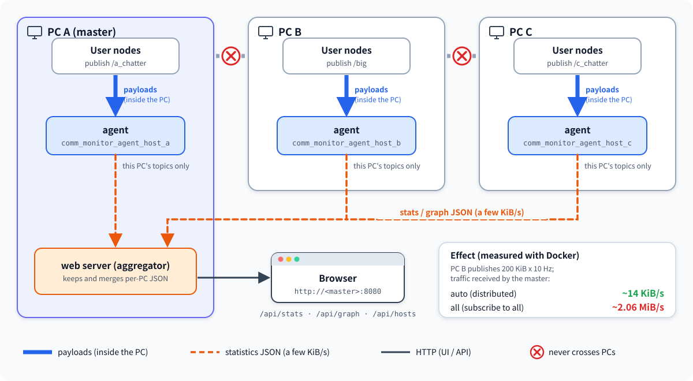
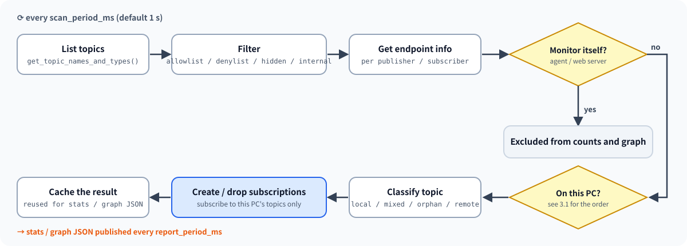
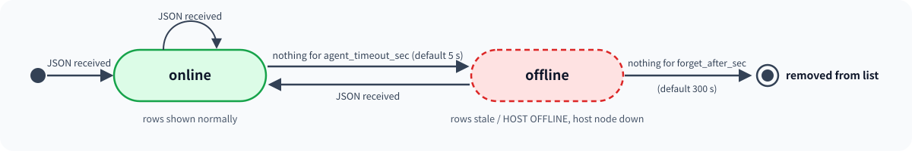
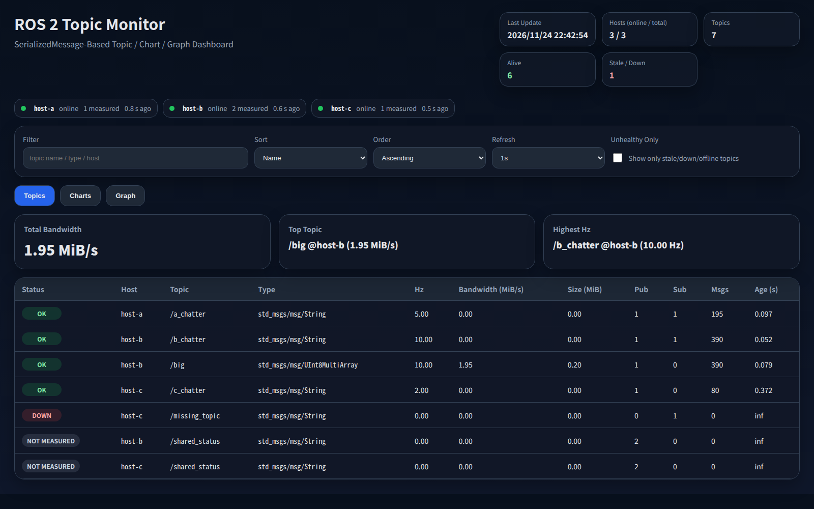
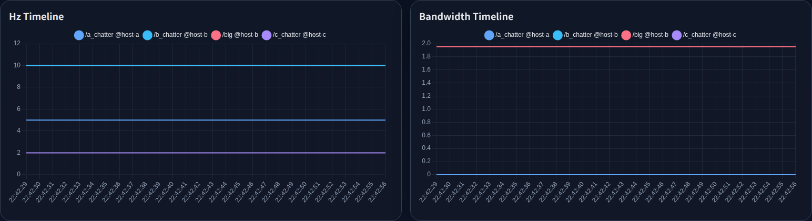
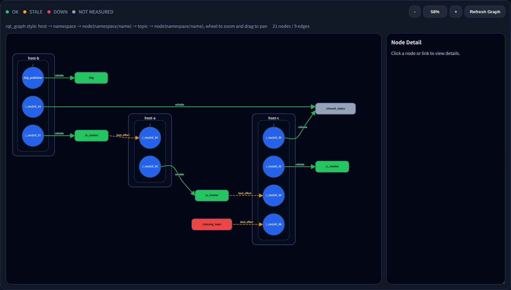
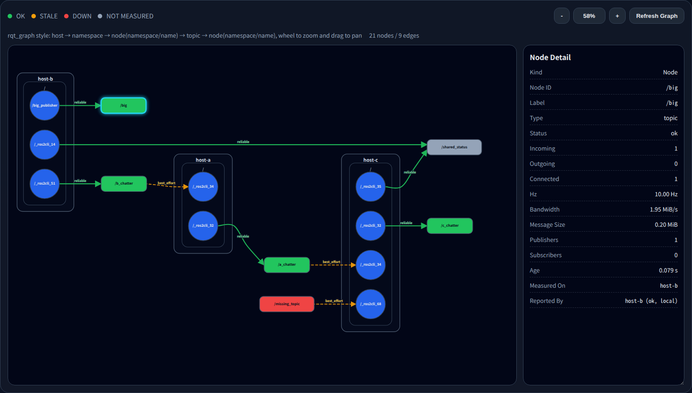
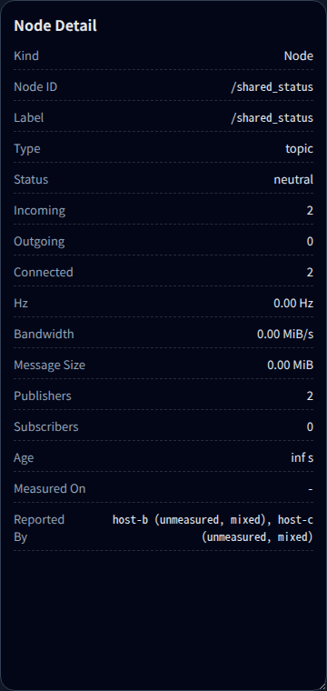
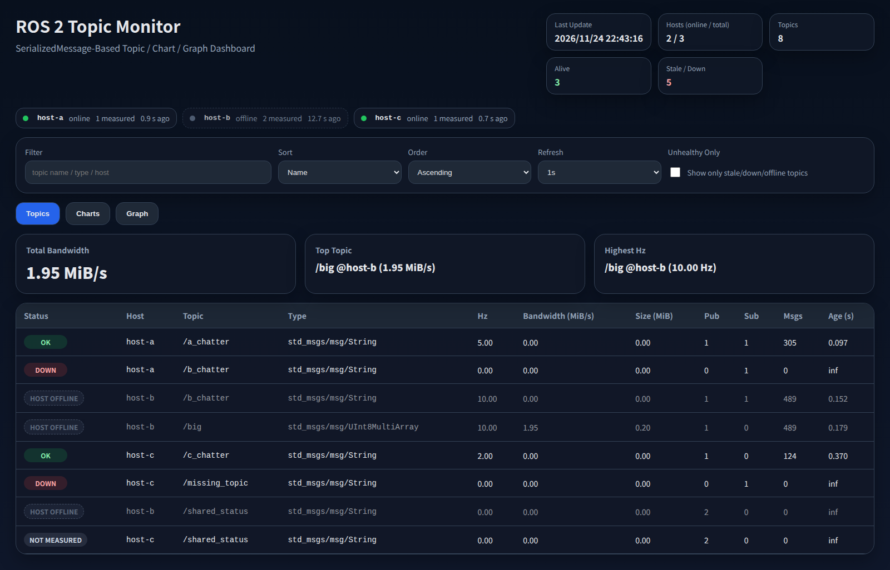
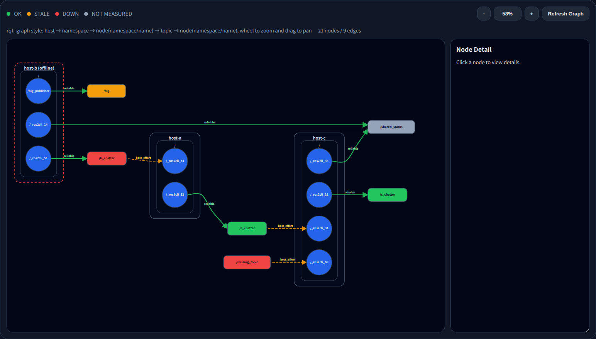

# System Overview: ros2_comm_monitor (distributed monitoring)

[日本語](./system_overview.ja.md) ・ [README](../README.md)

This document explains how the monitor works when a ROS 2 system spans several PCs:
the overall architecture, each component's role, the classification and merge rules,
and what the Web UI shows. For the full parameter list, see "Distributed Monitoring" in the README.

All screenshots were captured with `test/multihost/demo_screenshots.sh`
(three PCs simulated with Docker; see [Web UI](#5-web-ui)).

---

## 1. Architecture



The three key ideas:

| Principle | What it means |
|---|---|
| Payloads never leave their PC | An agent subscribes only to topics published on its own PC. Other PCs' topics are measured by those PCs' agents |
| Only statistics travel | Each agent publishes small stats / graph JSON (Hz, bandwidth, connections) every second |
| The master aggregates | The web server keeps the latest JSON per host, merges it, and serves the UI and APIs |

Measured effect (Docker; PC B publishes 200 KiB x 10 Hz, traffic received by the master):

| Master agent setting | Master receives |
|---|---|
| `locality_mode:=auto` (distributed) | ~14 KiB/s |
| `locality_mode:=all` (previous behavior, subscribe to everything) | ~2.06 MiB/s |

---

## 2. Components

| Package | Executable | Role |
|---|---|---|
| `serialized_topic_monitor` | `serialized_topic_monitor_node` (agent) | One per PC. Subscribes to this PC's topics with `GenericSubscription` and measures Hz / bandwidth / staleness without deserializing. Publishes stats / graph JSON |
| `topic_monitor_web_server` | `topic_monitor_web_server` (master) | Subscribes to every agent's JSON and keeps it in `ClusterState`. Serves merged results over HTTP plus the static UI |
| `ros2_comm_monitor` | launch files | `agent.launch.py` (each PC), `master.launch.py` (master; also starts its own agent by default), `bringup.launch.py` (single-PC compatibility). Shared argument definitions live in `ros2_comm_monitor.launch_common` |

Main source files:

| File | Contents |
|---|---|
| `serialized_topic_monitor/src/locality.cpp` | Host detection from GIDs (`is_fastdds_gid` / `compare_host` / `gid_host_tag` / `gid_participant_prefix`), name pattern matching |
| `serialized_topic_monitor/src/serialized_topic_monitor.cpp` | Scan, topic classification, subscription management, JSON generation |
| `topic_monitor_web_server/topic_monitor_web_server/web_server.py` | `ClusterState` (per-host storage, offline detection, merging), HTTP handler |
| `topic_monitor_web_server/static/app.js` | UI (table, charts, ELK graph rendering) |

---

## 3. Agent: one scan

Every `scan_period_ms` (default 1 s) the agent walks the ROS graph and caches the result.
Stats / graph JSON are generated from that cache every `report_period_ms` (default 1 s).



### 3.1 "Is this endpoint on this PC?"

Checked top to bottom for each endpoint:

| # | Condition | Result |
|---|---|---|
| 1 | `locality_mode:=all`, or env `ROS_AUTOMATIC_DISCOVERY_RANGE=LOCALHOST` / `ROS_LOCALHOST_ONLY=1` | this PC |
| 2 | Node namespace matches `local_node_namespaces`, or node name / FQN matches `local_node_names` (trailing `*` = prefix) | this PC |
| 3 | Fast DDS: bytes 2–3 of the endpoint GID (host id) equal those of the agent's own publisher GID | this PC |
| 4 | Anything else (another PC, or undeterminable) | other PC |

Fast DDS GUID layout (first 12 bytes of the GID):

```text
 byte:  0    1  | 2    3  | 4  5  6  7 | 8  9 10 11 | 12..15
       0x01 0x0F| host id |  process id | participant| entity id
       vendor id|          |             |  counter   |
```

With a non-Fast-DDS RMW, `locality_mode:=auto` and no `local_node_*` setting, the agent logs a WARN
at startup and measures nothing (the safe choice: it never subscribes to another PC's topics by mistake).

### 3.2 Topic classification

| `locality` | Publishers | Reported in stats | Subscribed (measured) | Graph status |
|---|---|---|---|---|
| `local` | all on this PC | yes | yes | measured (ok / stale / down) |
| `mixed` | this PC and other PCs | yes | only with `subscribe_policy:=any_local` | `neutral` if not measured |
| `orphan` | none (a subscriber on this PC) | yes, as DOWN | no | `down` |
| `remote` | other PCs only | no (that PC's agent reports it) | no | `neutral` (only in the graph if this PC subscribes) |

### 3.3 Excluding the monitor itself

Nodes that publish or subscribe the stats / graph topics (agents, web servers) are the monitor itself
and are excluded from counts and the graph.

- Normally they are identified by node FQN.
- When node names come back as `_NODE_NAME_UNKNOWN_` (e.g. Humble and Jazzy mixed; their `ros_discovery_info`
  is incompatible), they are identified by DDS participant (first 12 GID bytes = one process) instead.
  Registering the placeholder name would drop *every* unknown-name endpoint
  (found and fixed with the Docker Humble/Jazzy test).

---

## 4. Master: aggregation (ClusterState)

`ClusterState` keeps the latest stats / graph and receive time per host name (`host` in the JSON;
legacy payloads without it become `local`). The clock is injectable; tests use a fake one.

### 4.1 Host state



### 4.2 Merge rules

| Target | Rule |
|---|---|
| stats | One row per (host, topic). Rows from offline hosts get `stale=true`, `host_online=false` |
| graph nodes / edges | Union over hosts (deduplicated by id). Topic node id = topic name (shared by all PCs); ROS node id = `node://<host>::<fqn>` |
| graph host nodes | `ok` when online, `down` when offline |
| graph topic status | When several hosts report a topic, decided by the precedence below |

Topic status precedence (highest first):

1. An online host's judgement: `ok` > `stale` > `down`
2. What an offline host last reported: `ok` (downgraded to `stale`) > `stale` > `down`
3. `neutral` (not measured anywhere)

This keeps stale data from a stopped PC from overriding a live PC's judgement. For example, when the PC that
publishes a topic stops, the topic is shown with the subscriber PC's judgement (`down`).
The UI graph uses the same precedence.

### 4.3 API

| Endpoint | Contents |
|---|---|
| `/api/stats` | Merged stats (`topics[]` per (host, topic)), plus `hosts`, `host_count`, `online_host_count` |
| `/api/graph` | Merged graph |
| `/api/hosts` | Per host: `online`, `last_seen_age_sec`, `agent_node`, `rmw`, `locality_mode`, `subscribe_policy`, `topic_count`, `monitored_topic_count` |

Subscriptions are reliable, depth 50 (agents publish reliable, depth 10) so payloads from many PCs do not
overwrite each other. Invalid JSON is dropped and counted, with a WARN throttled to once per 10 s.

---

## 5. Web UI

The screenshots come from a three-PC Docker setup:

| PC | ROS | Running |
|---|---|---|
| host-a (master) | Jazzy | web server + agent; publishes `/a_chatter`, subscribes `/b_chatter` |
| host-b | Jazzy | agent; publishes `/big` (200 KiB x 10 Hz), `/b_chatter`, `/shared_status` |
| host-c | Humble | agent; publishes `/c_chatter`, `/shared_status`; subscribes `/a_chatter`, `/missing_topic` |

`/shared_status` is a `mixed` topic (published on two PCs); `/missing_topic` is an `orphan` topic
(subscribers only). The `/_ros2cli_*` nodes in the graph are the `ros2 topic pub` / `ros2 topic echo` processes used by the demo.

### 5.1 Topics tab



- **Header**: `Hosts (online / total)`. `Stale / Down` counts DOWN, STALE and HOST OFFLINE rows (not NOT MEASURED).
- **Host bar**: per host, online / offline, number of measured topics, seconds since the last JSON.
  Hover for agent node, RMW, `locality_mode`, `subscribe_policy`.

  

- **Table**: one row per (host, topic); the Host column shows which PC measured it.
  The filter matches topic name, type and host; Host was added to the sort options.
  Hover a row to see `locality` and the local / remote publisher split.
- **Top Topic / Highest Hz**: shown as `topic @host` when there are 2+ PCs.

Status badges:

| Badge | Meaning |
|---|---|
| `OK` | measured, received within `stale_timeout_sec` |
| `STALE` | measured, but nothing received recently |
| `DOWN` | no publisher (orphan) |
| `NOT MEASURED` | reported but not measured on this PC (`mixed` with `local_only`) |
| `HOST OFFLINE` | the reporting PC's agent stopped sending JSON; values are the last received ones and the row is dimmed |

### 5.2 Charts tab



Only measured topics are plotted (NOT MEASURED rows are not). With 2+ PCs, series are named `topic @host`.

### 5.3 Graph tab



- Nested host → namespace → node; each node is drawn inside its own PC's box.
- Topic nodes are shared by all PCs, so cross-PC communication (e.g. host-b's `/b_chatter` → a subscriber on host-a)
  shows up as edges crossing PC boxes.
- Topic colors: green = OK, orange = STALE, red = DOWN, **grey = NOT MEASURED** (measured nowhere).
- Edge color / dash show the reliability QoS (reliable = solid green, best_effort = dashed orange).

Click a topic to see details. `Measured On` is the measuring PC; `Reported By` lists each reporting PC's state.



Detail of the `mixed` topic `/shared_status`: reported by two PCs, measured by neither.



### 5.4 When a PC stops (host-b's agent stopped)

After about 5 s (`agent_timeout_sec`) the host turns offline.



- In the host bar, host-b becomes offline (grey dot, dashed frame) and its "seconds ago" keeps growing.
- host-b's rows become `HOST OFFLINE` and keep their last values.
- host-a's `/b_chatter` becomes `DOWN`: only its subscriber remains, and the publisher's PC (host-b) is gone.



- host-b's box becomes a dashed red frame labelled `(offline)`.
- `/big` is `STALE` (orange): only host-b's last data exists.
- `/b_chatter` is `DOWN` (red): the live host-a's judgement (no publisher) takes precedence.
- `/shared_status` stays grey: no PC measures it.

---

## 6. Launch

```bash
# every PC except the master
ros2 launch ros2_comm_monitor agent.launch.py

# master PC (web server + the master's own agent)
ros2 launch ros2_comm_monitor master.launch.py
# -> http://<master IP>:8080

# non-Fast-DDS RMW (e.g. Cyclone DDS on a PC whose nodes live under /robot1)
ros2 launch ros2_comm_monitor agent.launch.py local_node_namespaces:="['/robot1*']"
```

All PCs must share the same `ROS_DOMAIN_ID` and be able to discover each other.
For a single PC, `bringup.launch.py` still works.

---

## 7. Tests

| Kind | Command | Contents |
|---|---|---|
| Unit | `colcon test` | gtest (estimator, locality), pytest (ClusterState merging, offline, APIs) |
| Multi-host | `test/multihost/run_test.sh` | Three PCs in Docker (2x Jazzy, 1x Humble). Checks per-host measurement, graph placement, master traffic with `auto` vs `all`, offline detection. Exit code 0 = pass |
| Screenshots | `test/multihost/demo_screenshots.sh` | The same setup plus demo topics; captures this document's images into `docs/screenshots/` (needs Python Playwright) |

---

## 8. Limitations

- Automatic detection (`locality_mode:=auto`) supports Fast DDS only. The 16-bit host id in the GUID can (rarely) collide between PCs.
- `mixed` topics are not measured with the default `subscribe_policy:=local_only` (NOT MEASURED).
- Endpoints whose host cannot be determined (e.g. nodes on a different RMW than the agent) are not local unless matched by `local_node_*`.
- With mixed ROS distributions, the other side's node names are unknown. Data and JSON flow and the merged graph is unaffected, but ROS 2 does not officially support cross-distro communication.
- Two agents with the same `host_name` overwrite each other's JSON.
